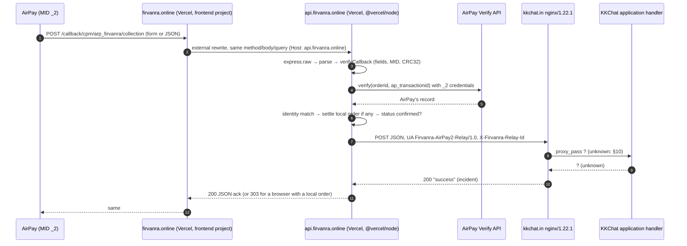

# Firvanra AirPay 2 → KKChat: callback forwarding setup and diagnostics

Branch: `fix/airpay2-kkchat-end-to-end-diagnostics`, from `origin/main` @ `275ed38` (PR #3 merge).
Status: ready for review. **Not merged, not deployed.** The incident below is **not resolved.**

Legend: **[code]** read in this repository's source. **[frontiva-src]** read in `vishnuweb-a/store`
@ `c9f6899` (cloned read-only). **[brief]** stated in the task brief and not independently verified.
**[log]** the reported production log line. **[owner]** needs a human with dashboard access.
**[hypothesis]** not established.

> **About the reference guide.** The task refers to an uploaded "Airpay Callback → Frontiva → KKChat:
> Step-by-Step Setup & Fix Guide". That Markdown file was not included in this task. Its nine-step
> order (flow, dashboard URLs, environment, deployment, receiver contract, testing, logs, regression
> tests, rollback) is followed below, using the brief's description of it. Statements about
> Frontiva's *behaviour* come from its source code [frontiva-src], not from that guide.

---

## 0. The incident (open)

| Fact | Value | Source |
|---|---|---|
| Order ID | `68862341366613893` (no Firvanra order, so it belongs to KKChat) | [log] |
| AirPay transaction | `2091680468` | [log] |
| Incoming | form body, channel `ambiguous` (no browser navigation headers) | [log] |
| Verification | `verified`, outcome `paid`, local order `unknown` | [log] |
| Outgoing | `POST https://kkchat.in/callback/cpm/arp_firvanra/collection`, `Content-Type: application/json` | [log] + [code] |
| Response | HTTP 200, `Server: nginx/1.22.1`, `Content-Type: application/json;charset=ISO-8859-1`, 7 bytes, bare word `success` | [log] |
| Firvanra's verdict | `transport_delivered: true`, `response_valid: false`, `response_issue: malformed_json`, `acknowledgement: unconfirmed`, `payment_recorded: unconfirmed` | [log] |
| KKChat's report | no callback received | [brief] |

**What is established:** AirPay's Verify API confirmed the payment. Firvanra sent one HTTP POST to
the exact KKChat URL, and *some* HTTP server on `kkchat.in` answered 200.

**What is not established:** which KKChat software produced that 200, whether KKChat's payment
handler ran, and whether the order was credited. A 200 proves only that an HTTP endpoint answered.

**Do not** replay this callback or send any forged paid callback to either endpoint. First get
KKChat's answer to §10.

### Verified cause vs. hypotheses

No root cause is verified. Firvanra behaved as designed: it verified, forwarded and got a 2xx.
The gap is on the receiving side, or in what the receiver expects. Hypotheses, most likely first:

| # | Hypothesis | For | Against / unknown | How to settle |
|---|---|---|---|---|
| H1 | **KKChat's application has no (or a generic) handler for `arp_firvanra`.** Frontiva relays to `…/arp_frontiva/collection` [frontiva-src]. `arp_firvanra` may not be registered, or may not be linked to the AirPay 2 MID, and a generic `/callback/**` mapping answers `success`. | The working reference uses a different path segment. The receiver answers a bare `success` even though Firvanra's log could not show it was processed. | KKChat's route table is unknown. | KKChat: show the controller/route that serves `/callback/cpm/arp_firvanra/collection` and its merchant mapping. |
| H2 | **The body shape doesn't match what the handler reads.** Examples: the handler reads form parameters (`request.getParameter`), which are empty for a JSON body; or it reads uppercase keys (`MERCID`, `TRANSACTIONID`…) and Firvanra relays whatever names AirPay posted, possibly lowercase. Nulls are then swallowed and `success` is still returned. | `charset=ISO-8859-1` is the default of a Java servlet container when a handler sets only `application/json`. That suggests the request reached an upstream app rather than an nginx `return 200`. | The field names actually sent for `2091680468` were **never logged** and cannot be reconstructed. | Debug records (§7) log the field names of the next eligible callback. KKChat: say which names and which body type the handler reads. |
| H3 | **KKChat looked in the wrong log.** The request is in nginx/app access logs but not in the payment log, because the payment log only records parsed and matched orders. | Common pattern. | — | KKChat: grep the nginx access log for the time window and for `Firvanra-AirPay2-Relay` (from this branch on). |
| H4 | **A different host or vhost answered.** From Vercel, `kkchat.in` may resolve to another server, an IPv6 address or an nginx `default_server` that is not the one KKChat checked. | `Server: nginx/1.22.1` doesn't identify the upstream. | — | Debug records log `destination_addresses` as resolved by the Vercel instance. KKChat: confirm those IPs are theirs. |
| H5 | **A catch-all or default success responder.** A WAF, maintenance rule or framework fallback returns `success` for any POST. | Same evidence as H1. | — | KKChat: upstream target and status for the request in the nginx log. |

**Ruled out [code]:** the charset. JSON's structure is ASCII, and the body was simply not JSON. A
redirect (the status was 200, not 3xx). A timeout or network error. Firvanra not sending at all,
because a response came back. The query string: the callback verified from its body fields alone,
so the query cannot have held needed data.

---

## 1. Flow (baseline audit)



Steps 9–11 are where the evidence ends. Only KKChat can show that step 9 happened.

### Routing [code]

- `frontend/vercel.json`: the rewrite `/callback/cpm/arp_firvanra/collection` →
  `https://api.firvanra.online/callback/cpm/arp_firvanra/collection` comes **before** the SPA
  catch-all, and there is no `redirects` block. A 30x would turn AirPay's POST into a GET. A test pins this.
- `backend/vercel.json`: `/(.*)` → `/server.js`.
- `backend/server.js`: `app.post(AIRPAY2_CALLBACK_PATH, express.raw, handler)` is registered
  **before** the global JSON/urlencoded parsers. `GET` on the same path returns 405 and touches no state.
- Inside the handler, `Host` is `api.firvanra.online`. The public domain survives only in
  `X-Forwarded-Host`. Nothing in the handler reads either header, so routing and the KKChat
  destination cannot be steered by them.

### Every branch of the handler [code] (`backend/routes/airpay2.js`)

| # | Condition | Response | Settles? | Forwards? |
|---|---|---|---|---|
| 1 | `GET` (browser or anything else) | 405 `Allow: POST` | no | no |
| 2 | empty body, malformed JSON, JSON that is not an object | 400 | no | no |
| 3 | any `_2` credential missing | 503 | no | no |
| 4 | `verifyCallback`: `incomplete` (no orderid / ap txn id / amount / status / hash), `merchant_id` ≠ MID 2, CRC32 mismatch | 400 | no | no |
| 4a | …an **encrypted envelope** `{merchant_id, response}` falls under `incomplete` | 400; **new:** field names + `envelope_suspected` logged | no | no |
| 5 | Verify API unreachable, logical error or no record | 503 | no | no |
| 6 | Verify record differs on orderid / txn / merchant / amount / currency | 400 | no | no |
| 7 | local order: unknown (KKChat's), other gateway, amount mismatch | — | no | (continues) |
| 8 | callback claims paid but verify says otherwise | 503 | no | no |
| 8a | callback status superseded by verify (e.g. late failure after success) | 200 `forwarded:false` | no | no |
| 9 | duplicate of a delivered event (same instance) | 200 `duplicate:true` | (idempotent) | no |
| 10 | relay fails: non-2xx, redirect, timeout, network; or strict/ack rule not met | 502 | yes (kept) | attempted |
| 11 | relay 2xx | 200 JSON (browser with local order: 303 to the order page) | yes | yes |

Channel: a JSON body is `ipn`; a form body with `Accept: text/html` or `Sec-Fetch-Mode: navigate`
is `browser`; any other form body is `ambiguous`. This picks only the response body (HTML or JSON),
never the status. The incident callback was `ambiguous`, which is what a server-to-server form IPN
looks like.

### Firvanra vs. Frontiva [frontiva-src]

| Aspect | Frontiva (`api/_lib/forward-callback.js`, `api/payments/callback.js`) | Firvanra | Does the difference stop delivery? |
|---|---|---|---|
| KKChat path | `/callback/cpm/arp_frontiva/collection` (+ server-only `KKCHAT_CALLBACK_URL` override) | `/callback/cpm/arp_firvanra/collection`, a constant | **Possibly (H1).** The path is mandated, so KKChat must serve it. |
| Input | query ∪ body (body wins) | body only | No: the incident verified from its body. |
| Order | forwards **before** verification, every callback | verifies first; forwards only verified, status-confirmed callbacks | No for genuine payments. Kept deliberately (§8). |
| Encrypted envelope | best-effort decrypt for its own use; relays the received payload | rejected as `incomplete` (400), not relayed | Only if AirPay 2 sends envelopes. No evidence that it does; now logged (4a). |
| Body | `JSON.stringify(payload)` | form → JSON object with original names and string values; JSON → original bytes | No difference in the field names relayed. |
| Headers | `Content-Type`/`Accept: application/json`, `User-Agent: Frontiva/1.0 (+https://frontiva.online)`, `x-frontiva-forwarded: 1` | before: `Content-Type`/`Accept` only (Node's fetch default UA). **Now:** `User-Agent: Firvanra-AirPay2-Relay/1.0 (+https://firvanra.online)`, `X-Firvanra-Relay-Id: fr-<uuid>` | Only if KKChat allowlists a UA or marker. Firvanra does **not** impersonate Frontiva. If KKChat needs a marker, agree a Firvanra-specific one. |
| Redirects | follows one same-host https 307/308 | never follows; failure, not delivered | Only if KKChat redirects. The incident got a 200. |
| Attempts | 1 | up to 2 on 5xx / 429 / timeout / network | No. |
| Reply to AirPay | always 200, independent of forwarding | 502 when the relay fails (re-send signal) | No. |

---

## 2. AirPay dashboard checklist [owner]

No dashboard was inspected for this change. Merchant **AirPay 2** (the MID in `AIRPAY_MID_2`) only:

- [ ] **Response URL** is exactly `https://firvanra.online/callback/cpm/arp_firvanra/collection`
- [ ] **IPN URL** is exactly `https://firvanra.online/callback/cpm/arp_firvanra/collection`
- [ ] `https`, apex domain (no `www.`), no trailing slash, no query string
- [ ] Not pointed directly at `kkchat.in`. Firvanra must verify first, and a direct URL bypasses it.
- [ ] The MID shown is the one in `AIRPAY_MID_2`, and its API credentials are the `_2` set
- [ ] **AirPay 1 is untouched**: its URLs stay as they are
- [ ] IPN is enabled. The browser Response URL never fires when the customer closes the tab; only
      the IPN reaches Firvanra (and so KKChat) in that case.

---

## 3. Environment [owner checks values; names only here]

Read per call by `backend/services/airpay2.js` and `backend/services/kkchatForwarder.js` [code].
There is no fallback to merchant 1 credentials. List the names on the **API** Vercel project with
`vercel env ls production` (values are not printed), or in Project → Settings → Environment Variables.

| Name | Required | Purpose |
|---|---|---|
| `AIRPAY_MID_2` | yes | merchant id |
| `AIRPAY_USERNAME_2` | yes | |
| `AIRPAY_PASSWORD_2` | yes | |
| `AIRPAY_API_KEY_2` | yes | privatekey secret |
| `AIRPAY_CLIENT_ID_2` | yes | OAuth2 |
| `AIRPAY_CLIENT_SECRET_2` | yes | OAuth2 |
| `AIRPAY_ENCRYPTION_KEY_2` | no | default `md5(username~:~password)` |
| `AIRPAY_OAUTH_URL_2`, `AIRPAY_PAY_URL_2`, `AIRPAY_VERIFY_URL_2` | no | endpoint overrides; leave unset unless AirPay says otherwise |
| `AIRPAY2_KKCHAT_FORMAT` | no | unset/`json` (default). `form`/`raw` = rollback to raw bytes |
| `AIRPAY2_KKCHAT_STRICT_RESPONSE` | no | unset (default). `true` = a non-JSON 2xx fails with 502 |
| `AIRPAY2_KKCHAT_ACK` | no | **leave unset** until KKChat documents a response field, e.g. `status=success` |
| `AIRPAY2_KKCHAT_DEBUG` | no | **new.** `true` to allow debug records (§7) |
| `AIRPAY2_KKCHAT_DEBUG_UNTIL` | with DEBUG | **new.** ISO-8601 end of the window, ≤ 7 days ahead; debug is off without it |
| `AIRPAY2_KKCHAT_DEBUG_ORDER_ID` | with DEBUG | **new.** ≤ 5 comma-separated order ids |
| `AIRPAY2_KKCHAT_DEBUG_TXN_ID` | with DEBUG | **new.** ≤ 5 comma-separated AirPay transaction ids |
| `FRONTEND_URL` | yes (prod) | browser redirect base, `https://firvanra.online` |
| `VERCEL_GIT_COMMIT_SHA`, `VERCEL_GIT_COMMIT_REF`, `VERCEL_ENV` | system | shown by `/api/health/version`; needs "Automatically expose System Environment Variables" (Vercel default) |

The KKChat URL is deliberately a **code constant**. There is no `KKCHAT_CALLBACK_URL`. A
configurable destination would let anyone with env access redirect verified payment data. If it is
ever needed, use a server-only value checked against a fixed allowlist (`https://kkchat.in/` + this
exact path) and fail closed.

Changing environment variables takes effect only after a **redeploy**. The one exception is the
debug window's end time: debug turns itself off at `AIRPAY2_KKCHAT_DEBUG_UNTIL` without a redeploy.

---

## 4. Deployment and route verification

1. Review and merge the PR. A push to `main` auto-deploys the Vercel projects. Confirm in Vercel which
   project serves `api.firvanra.online`.
2. Confirm the build that is serving (new endpoint, read-only, no configuration state):
   ```sh
   curl -s https://api.firvanra.online/api/health/version
   # {"ok":true,"service":"firvanra-api","commit":"<12 hex>","ref":"main","environment":"production",
   #  "airpay2_callback_path":"/callback/cpm/arp_firvanra/collection"}
   ```
   `commit` must equal the merge commit. Before this branch is deployed, the endpoint does not exist,
   so use Vercel → Deployments. `GET /api/health` is unchanged: `{ok:true,service:"firvanra-api"}`.
3. Method-safe route checks. These never verify, settle or forward:
   ```sh
   # Rewrite reaches Express (the SPA would answer 200 HTML): expect 405
   curl -s -o /dev/null -w "%{http_code}\n" https://firvanra.online/callback/cpm/arp_firvanra/collection
   # POST reaches the handler with method intact: expect 400 {"error":"Invalid AirPay callback"}
   curl -s -X POST -H "Content-Type: application/json" -d "{}" https://firvanra.online/callback/cpm/arp_firvanra/collection
   ```
   Do **not** POST anything that looks like a paid callback.
4. A browser `GET` return currently gets a JSON 405. AirPay posts its Response URL, and there is no
   evidence of GET returns, so this is unchanged. If one is ever observed, add a static,
   state-free HTML page for `GET`. Never settle or forward from a GET.

---

## 5. Receiver contract: what KKChat receives

```
POST https://kkchat.in/callback/cpm/arp_firvanra/collection
Content-Type: application/json
Accept: application/json
User-Agent: Firvanra-AirPay2-Relay/1.0 (+https://firvanra.online)     ← new
X-Firvanra-Relay-Id: fr-<uuid v4>                                    ← new, one per attempt
```

Body: only for callbacks that passed verification (§1 table, row 11), with exactly the fields
AirPay posted. Nothing is renamed, added, dropped or re-typed, and `ap_SecureHash` is included.

| Incoming from AirPay | Outgoing to KKChat |
|---|---|
| form `merchant_id=…&orderid=…&ap_transactionid=…&amount=849.00&transaction_status=200&transaction_payment_status=SUCCESS&message=…&ap_SecureHash=…` | `{"merchant_id":"…","orderid":"…","ap_transactionid":"…","amount":"849.00","transaction_status":"200","transaction_payment_status":"SUCCESS","message":"…","ap_SecureHash":"…"}` (same order, all strings) |
| form with uppercase names (`MERCID`, `TRANSACTIONID`, `APTRANSACTIONID`, `TRANSACTIONSTATUS`, `TRANSACTIONPAYMENTSTATUS`, `AMOUNT`, `ap_SecureHash`) | the same uppercase names as a JSON object |
| JSON (any casing, nested values) | the **original bytes** |
| repeated form name (`a=1&a=2`) | last value wins (`"a":"2"`); debug records name the duplicate |
| query string | **not relayed** (names recorded in debug) |

**No field mapping is implemented.** KKChat's sample uses uppercase names. AirPay's form callbacks
may be lowercase. Whether KKChat accepts both is an open question (§10). If KKChat shows written
evidence that it accepts only uppercase, add a deterministic, outgoing-only, tested mapping. Even
then, `ap_SecureHash` is a CRC32 over field **values**, so renaming keys leaves it valid. Never
invent missing fields.

Response handling (unchanged): a 2xx is `transport_delivered`. `response_valid` means
`application/json` that also parses. `acknowledgement` stays `unconfirmed` unless `AIRPAY2_KKCHAT_ACK`
names a field KKChat really returns. `payment_recorded` is always `unconfirmed`, because only KKChat
knows. A bare `success` is **not** treated as an acknowledgement: no schema says it is one, and
treating it as one would say nothing about whether the payment was credited.

---

## 6. Safe testing, in increasing order of confidence

1. **Unit / route tests** (no network): `cd backend && npm test`. AirPay is mocked through axios, and
   KKChat through a fetch stub that records method, URL, headers and body.
2. **Local mock receiver.** Run the API locally, stub AirPay (as the tests do), and point a local copy
   of the forwarder at a capture server. Never bypass verification in a deployed build.
3. **KKChat connectivity test**, only with KKChat's consent and only to an endpoint they designate:
   ```json
   {"type":"connectivity_test","source":"firvanra","relay_id":"fr-<uuid>"}
   ```
   It has no transaction id, amount, status or signature, so it cannot credit anything. KKChat
   confirms that the nginx line, upstream and handler log all show it. Don't send it to the
   production callback without KKChat's agreement: a generic `success` or side effects would muddy
   the result.
4. **One authorised low-value real payment**, after review and deployment:
   - choose the order id in advance with KKChat;
   - set the debug window for that order id (§7) and redeploy;
   - pay; then trace AirPay txn → Firvanra summary + debug lines → KKChat nginx line
     (`Firvanra-AirPay2-Relay`, same relay id, same byte count) → KKChat handler log → KKChat ledger,
     credited **once**;
   - remove the debug variables and redeploy.
5. If KKChat again sees nothing while Firvanra logs a 200: compare `destination_addresses` with
   KKChat's servers (H4), then the nginx vhost/upstream (H1/H5), then log filters (H3). Change
   payment logic only after that.

**Never** reuse the Frontiva guide's fake paid-IPN curl against Firvanra. Firvanra rejects it
(hash, Verify API) by design. Never replay `2091680468` or any other paid callback.

---

## 7. Logs

Every verified callback logs one summary line. It now includes `relay_ids`:

```
[airpay2 callback] summary {"provider":"airpay2","channel":"ambiguous","format":"form",
 "orderid":"<orderid>","ap_transactionid":"<txn>","verification":"verified","outcome":"paid",
 "local_order":"unknown","forwarding":{"destination":"kkchat","status":"delivered",
 "request_format":"json","request_content_type":"application/json","transport_delivered":true,
 "http_status":200,"response_content_type":"application/json;charset=ISO-8859-1",
 "response_kind":"json","response_json":"malformed","response_content_type_json":true,
 "response_valid":false,"response_issue":"malformed_json","response_charset":"iso-8859-1",
 "response_bytes":7,"response_truncated":false,"response_shape":"word","response_word":"success",
 "response_server":"nginx/1.22.1","acknowledgement":"unconfirmed","payment_recorded":"unconfirmed",
 "attempts":1,"relay_ids":["fr-…"]}}
```

`status: delivered` means "KKChat answered 2xx". It does **not** mean processed.

### Opt-in debug records (new)

Enable for one controlled payment (API project, Production), then redeploy:

```
AIRPAY2_KKCHAT_DEBUG=true
AIRPAY2_KKCHAT_DEBUG_UNTIL=2026-10-24T18:00:00+05:30     # ≤ 7 days ahead; required
AIRPAY2_KKCHAT_DEBUG_ORDER_ID=<order id agreed with KKChat>
# or, after checkout: AIRPAY2_KKCHAT_DEBUG_TXN_ID=<AirPay transaction id>
```

For a matching callback, each attempt logs a `request` line before the fetch and a `response` line
after it:

```
[airpay2 forward debug] request {"orderid":"…","ap_transactionid":"…","debug_match":"order_id",
 "destination":"https://kkchat.in/callback/cpm/arp_firvanra/collection","method":"POST",
 "incoming_format":"form","request_format":"json","field_names":["merchant_id","orderid",…],
 "field_types":{"merchant_id":"string",…},"request_bytes":312,"request_sha256":"<64 hex>",
 "destination_addresses":["<ip>/v4"],"relay_id":"fr-…","attempt":1,"started_at":"…",
 "request_headers":{"Content-Type":"application/json","Accept":"application/json",
 "User-Agent":"Firvanra-AirPay2-Relay/1.0 (+https://firvanra.online)","X-Firvanra-Relay-Id":"fr-…",
 "Content-Length":"312"}}
[airpay2 forward debug] response {"relay_id":"fr-…","attempt":1,"orderid":"…","ap_transactionid":"…",
 "started_at":"…","ended_at":"…","elapsed_ms":143,"request_sent":true,"http_response_received":true,
 "http_status":200,"response_headers":{"content-type":"…","server":"nginx/1.22.1",
 "set_cookie_names":["JSESSIONID"]},"response_bytes":7,"response_kind":"json",
 "response_json":"malformed","response_charset":"iso-8859-1","response_shape":"word",
 "response_word":"success","response_issue":"malformed_json","transport_delivered":true,
 "response_valid":false,"application_acknowledged":false,"payment_recorded":"unconfirmed"}
```

A duplicate that is not re-sent logs `not_sent` with `duplicate_already_delivered` or
`duplicate_in_flight`. A thrown fetch reports `request_sent: "unknown"`, because it may have failed
before or after the bytes left.

**Never logged:** field values, the request or response body, `ap_SecureHash`, customer name, email
or phone, credentials, tokens, cookie values, query values, an encrypted envelope.
`request_sha256` is only for comparing bytes across systems. It is not authentication and not proof
of processing. In debug mode, `destination_addresses` adds one DNS lookup (≤ 1 s) per callback.

**Retention and deletion.** Debug lines are ordinary Vercel runtime logs, kept for as long as the
Vercel plan keeps them, plus any configured log drain. To stop: remove the four `AIRPAY2_KKCHAT_DEBUG*`
variables and redeploy. The window also closes by itself at `…_UNTIL`. To delete: let them age out,
or purge them in the log drain if one is configured.

These records only cover **future** eligible callbacks. The payload of `2091680468` cannot be
reconstructed.

### For KKChat: finding Firvanra's request

nginx's default `combined` log format records the User-Agent, so no configuration change is needed:

```sh
grep 'Firvanra-AirPay2-Relay' /var/log/nginx/access.log | grep 'arp_firvanra'
```

To see the relay id, add `$http_x_firvanra_relay_id` to the `log_format`, or log the
`X-Firvanra-Relay-Id` header in the application.

---

## 8. Forwarding policy (unchanged, documented)

- **Verify before forward.** Kept. Only callbacks with a valid MID 2 CRC32 that AirPay's Verify API
  confirms (same txn, order, merchant, amount, currency and status) are relayed. Frontiva relays
  everything unverified. Doing the same here would be a separate, **explicitly untrusted relay**
  design. It needs approval first, KKChat must verify with AirPay itself, and the public URL needs
  abuse controls. It is not implemented.
- **Attempts.** Up to 2 per callback on 5xx, 429, timeout or network error (300 ms back-off, 4 s
  timeout each). A 4xx, a redirect or a non-JSON 2xx is not retried. Trade-off: the second attempt
  can duplicate a delivery the receiver processed but answered slowly. A single attempt (Frontiva)
  loses more notifications. Either way, **KKChat must be idempotent on `APTRANSACTIONID` /
  `ap_transactionid`.** The business owner decides whether to keep 2.
- **Dedup** is in memory, per Vercel instance, and lost on cold start. Firvanra cannot promise
  exactly-once. No database is added.
- **Reply to AirPay.** A relay failure returns 502 so that AirPay may re-send. Whether AirPay
  actually retries IPNs, and on what schedule, is unconfirmed. A 2xx with a bad body is a delivery,
  not retried; `AIRPAY2_KKCHAT_STRICT_RESPONSE=true` reverses that.
- Every non-2xx, redirect, timeout and network failure is logged with `console.error` as
  `[airpay2 forward] failed:`.

---

## 9. Regression tests

Run (commands from `package.json`):

```sh
cd backend  && npm ci && npm test        # node --test, 10 files
cd frontend && npm ci && npm test && npm run build
```

Results on this branch: **backend 389/389 pass** (was 362, +27). **Frontend 43/43 pass.**
**Vite build succeeds**, and the bundle contains no `kkchat`, `AIRPAY2_KKCHAT` or `Relay-Id` string.

New tests (`backend/routes/payment.airpay2.test.js`, `backend/services/kkchatDiagnostics.test.js`,
`backend/server.health.test.js`):

- Firvanra User-Agent and a fresh relay id on every attempt, in JSON and form-rollback mode. No other
  outgoing headers.
- `relay_ids` in the summary equals the ids KKChat received.
- Debug: off by default; off for non-matching ids, a missing, invalid or expired window, a window
  over 7 days, or a flag other than `true`. On by order id or txn id.
- Debug content: destination, method, allowlisted headers, Content-Length, field names and types,
  SHA-256 of the exact bytes received. No hash, email, phone, amount, cookie value, credential or token.
- The exact incident response: 200, 7-byte `success`, `application/json;charset=ISO-8859-1`,
  `nginx/1.22.1`, cookie **names** only.
- Network failure → `request_sent: "unknown"`. A duplicate → `not_sent`.
- Duplicate form keys (last wins, name flagged), nested JSON (bytes preserved, types logged), query
  names (logged, values neither logged nor relayed).
- KKChat 429 retried once then 502. A GET carrying paid-callback fields never verifies, settles or forwards.
- An encrypted-envelope-shaped callback → 400, names logged, `envelope_suspected: true`, ciphertext not logged.
- `/api/health/version`: sanitised commit, ref and environment. No credential presence or secrets.

Already covered and still passing: exact public and KKChat URLs, rewrites before the SPA catch-all,
form / JSON / uppercase / lowercase payloads, malformed / empty / array / missing fields, merchant 2
identity, hash, Verify API and status checks, forged and wrong-merchant rejection, value
preservation (`849.0` stays `849.0`), valid JSON / HTML / text / empty / malformed 2xx, 3xx, 4xx,
5xx, timeout, network, strict and ack modes, duplicates and races, out-of-order callbacks, AirPay 1,
SabPaisa and PayU suites.

---

## 10. Evidence KKChat must provide (mandatory before closing)

For **2091680468 / 68862341366613893** (and later for the controlled payment):

1. The nginx access-log line(s) for `POST /callback/cpm/arp_firvanra/collection` around the callback
   time: timestamp, method, path, status, bytes, User-Agent, `$upstream_addr` and `$upstream_status`.
2. Which vhost / `server_name` and which upstream served it. Are the IPs Firvanra resolved KKChat's?
3. Was the application handler for `arp_firvanra` invoked? Its log line, and the code path that
   writes the `success` body.
4. Field names the handler received (names only), and the request byte count, to compare with
   Firvanra's `request_bytes` / `request_sha256`.
5. Contract: JSON or form body? Uppercase only, or both casings? Plaintext or encrypted envelope? Any
   required header, auth or CSRF exemption?
6. Is `arp_firvanra` mapped to the AirPay 2 MID's KKChat account?
7. Order `68862341366613893`: credited? If so, exactly once, and by what?
8. Idempotency key used (`APTRANSACTIONID` / `ap_transactionid`).
9. A documented success response (field + values) if they want `AIRPAY2_KKCHAT_ACK` used.

---

## 11. Rollback

| What | How |
|---|---|
| Debug records | Unset `AIRPAY2_KKCHAT_DEBUG*` and redeploy, or let `…_UNTIL` pass |
| Whole change (headers, debug, version endpoint, envelope log) | `git revert -m 1 <merge commit>` on `main`, push, and Vercel redeploys. There is no env toggle for the headers; they carry no payment data. |
| Request format (existing) | `AIRPAY2_KKCHAT_FORMAT=form` and redeploy (raw form bytes, original Content-Type) |
| Response strictness (existing) | `AIRPAY2_KKCHAT_STRICT_RESPONSE=true` and redeploy |

Nothing in this change touches credentials, AirPay 1, SabPaisa, PayU, settlement rules or the
verification order.

---

## 12. Status: four layers

| Layer | Status | Evidence |
|---|---|---|
| 1. AirPay verified the payment | **Confirmed** | Firvanra log: `verification: verified`, `outcome: paid` (Verify API, MID 2) |
| 2. Firvanra sent an HTTP POST and got a transport response | **Confirmed** | `transport_delivered: true`, HTTP 200, 7 bytes, `nginx/1.22.1` |
| 3. KKChat's intended handler received and accepted it | **Not confirmed**, contradicted by KKChat's report | needs §10 items 1–4 |
| 4. KKChat credited the payment exactly once | **Not confirmed** | needs §10 item 7 (ledger) |

Until layers 3 and 4 are confirmed by KKChat, do not replay or re-trigger the paid callback.
